# Data Visualizations Report

This report presents 15 visualizations generated from the cyberbullying dataset to understand its characteristics, potential biases, and features that can be used for classification.

## 1. Class Distribution
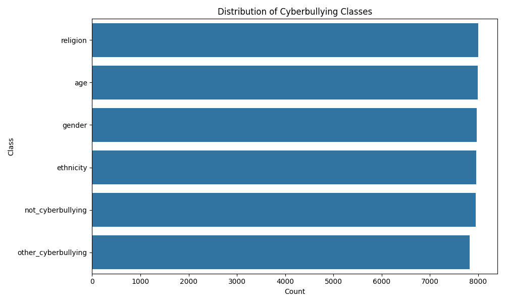
**Analysis:** This chart shows the balance of different cyberbullying classes. A balanced dataset is ideal for training; significant imbalances might require techniques like SMOTE or class weighting.

## 2. Tweet Length Distribution
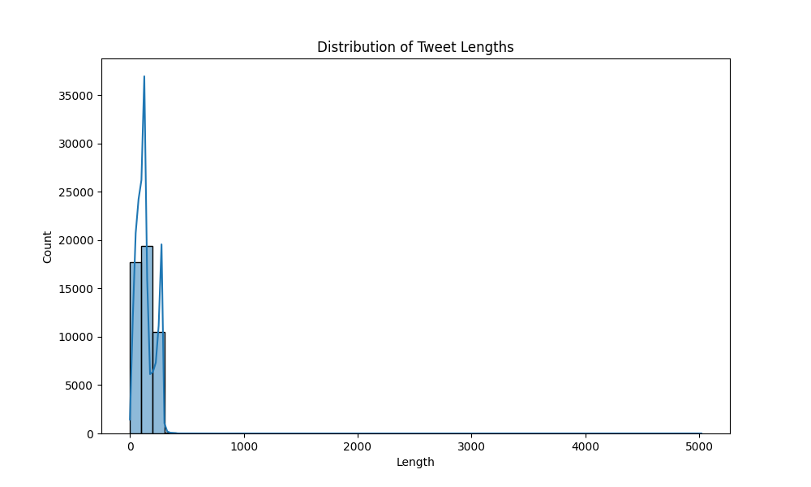
**Analysis:** Displays the distribution of character counts in tweets. Very short tweets might lack context, while very long ones might be outliers or spam.

## 3. Word Count Distribution
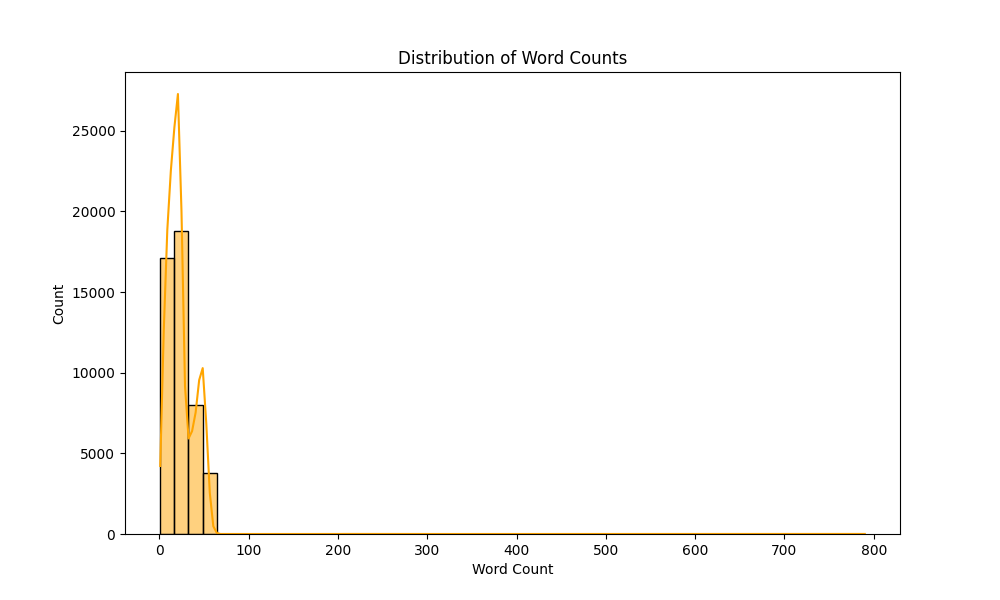
**Analysis:** Shows how many words are typically in a tweet. This helps in deciding the maximum sequence length for models like BERT or LSTM.

## 4. Average Word Length by Class
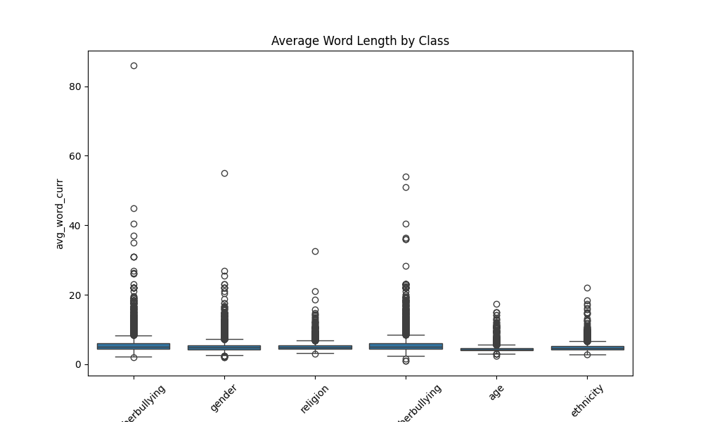
**Analysis:** Compares the complexity of vocabulary across classes. "Age" or "Ethnicity" bullying might use simpler or specific slurs compared to "Religion" or "Gender".

## 5. Sentiment Score Distribution (VADER)
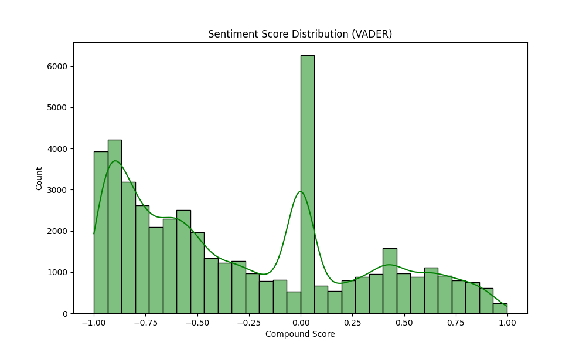
**Analysis:** The overall sentiment of the dataset. Cyberbullying tweets are expected to cluster around negative scores (below 0).

## 6. Sentiment Scores by Class
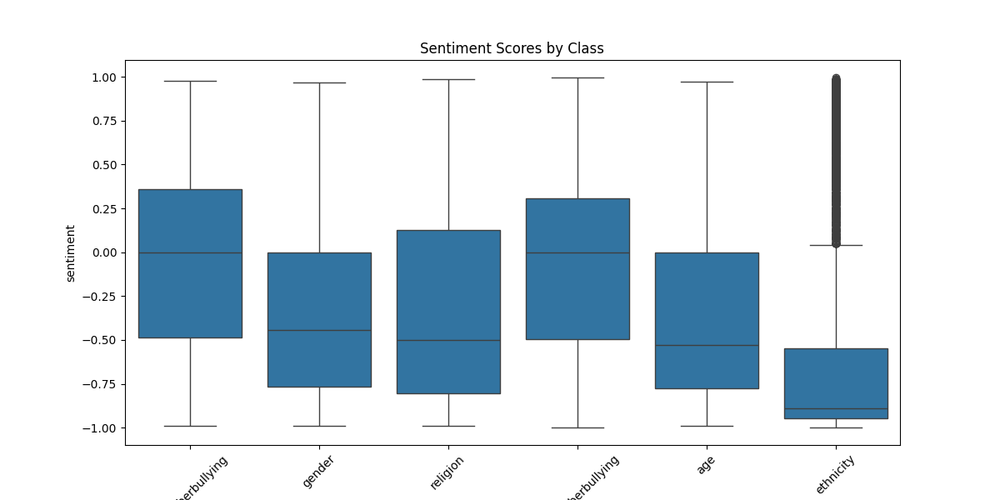
**Analysis:** detailed view of sentiment per class. Non-cyberbullying should have higher (positive/neutral) scores, while bullying classes should be lower. Overlap indicates difficulty in separation based solely on sentiment.

## 7. Top 20 Words in Cyberbullying
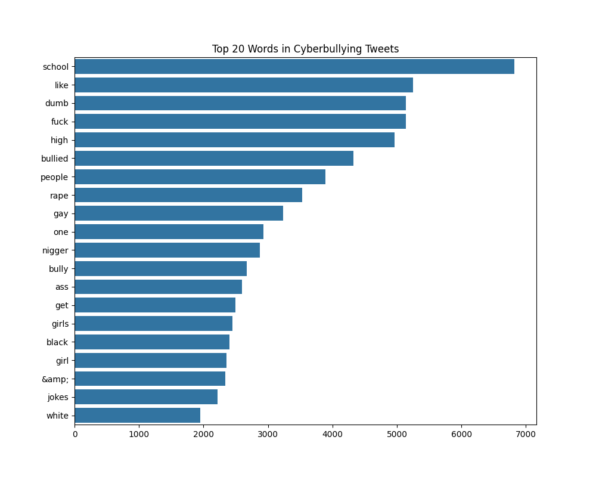
**Analysis:** The most frequent words in bullying tweets (excluding stopwords). These are likely the key indicators the model will learn.

## 8. Top 20 Words in Non-Cyberbullying
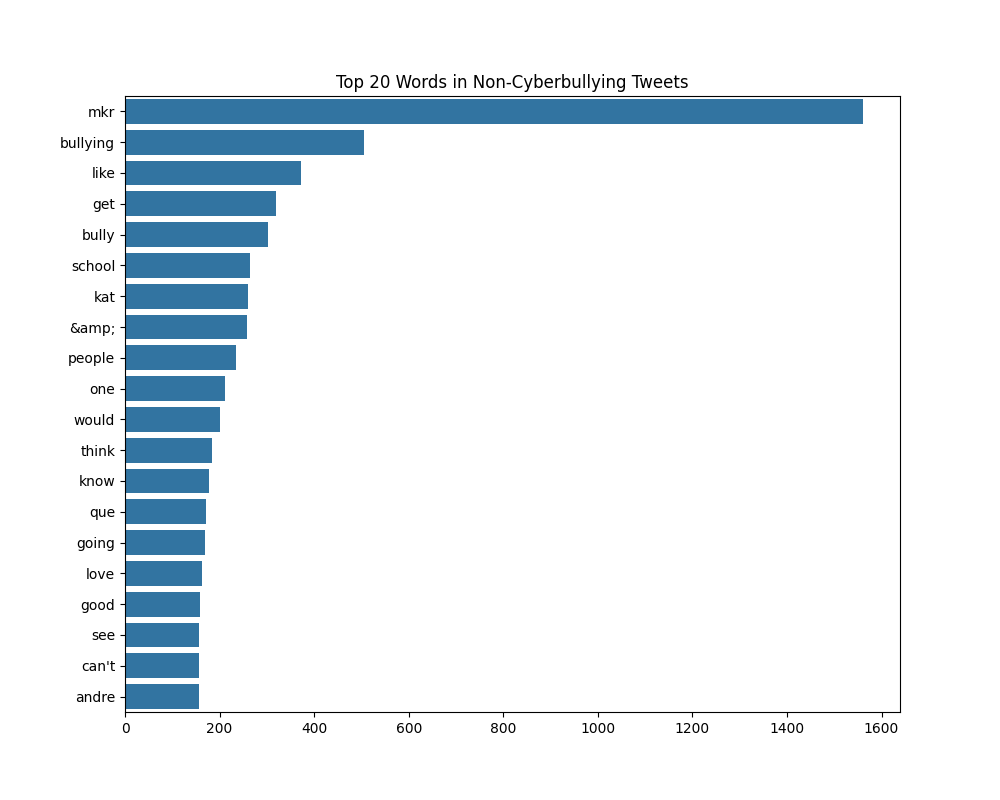
**Analysis:** Common words in safe tweets. These helps distinguish normal conversation from harassment.

## 9. Word Cloud - Cyberbullying
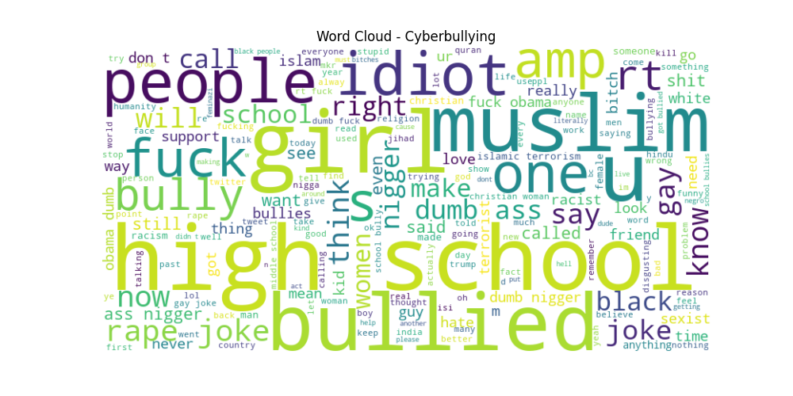
**Analysis:** A visual representation of the most prominent words in the cyberbullying class, giving a quick qualitative overview of the toxic vocabulary.

## 10. Word Cloud - Safe Tweets
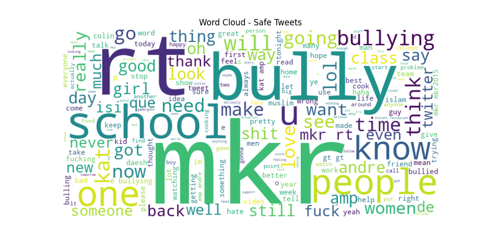
**Analysis:** A visual representation of the safe class vocabulary, typically showing more positive and neutral terms.

## 11. Top Bigrams in Cyberbullying
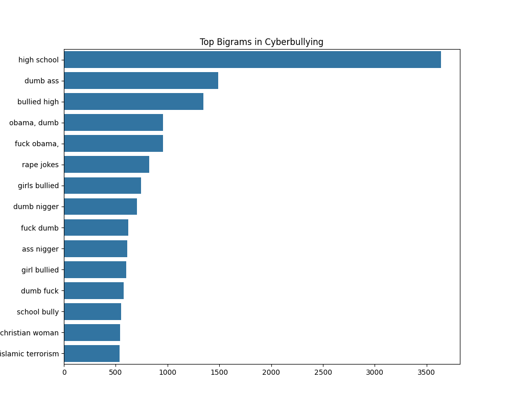
**Analysis:** The most common two-word phrases. Bigrams often capture more context than single words (e.g., "go back" vs "go").

## 12. Average Special Character Usage by Class
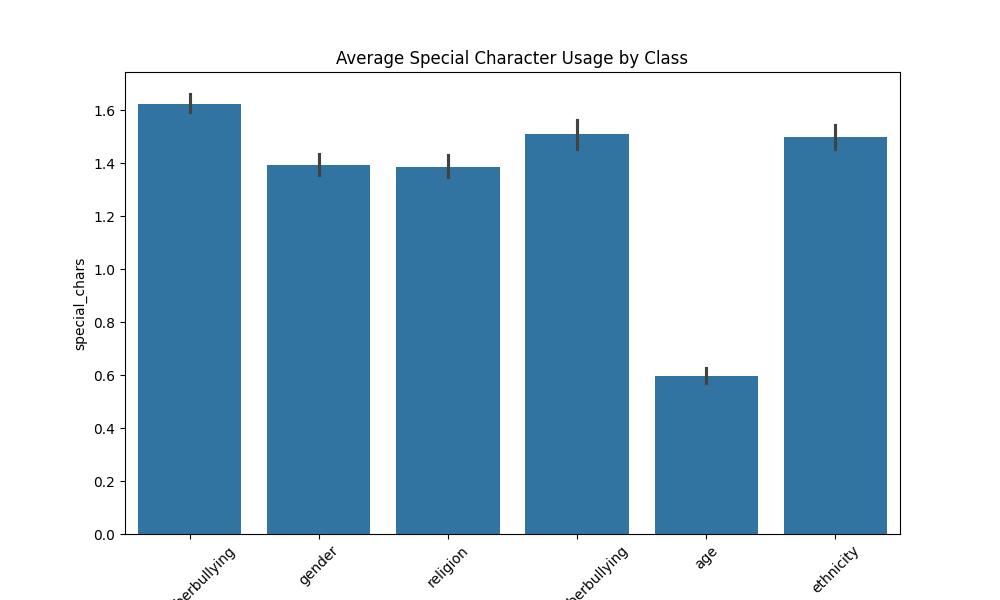
**Analysis:** Cyberbullying often involves aggressive punctuation (!!, ??, ***). This chart checks if certain classes use more special characters.

## 13. Vocabulary Richness (Unique vs Total Words)
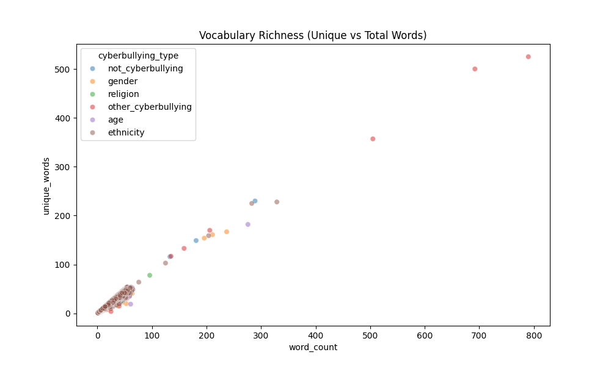
**Analysis:** Scatter plot showing the relationship between unique words and total words. Repetitive abuse might show lower richness compared to normal conversation.

## 14. Classified Tweets Dataset Distribution
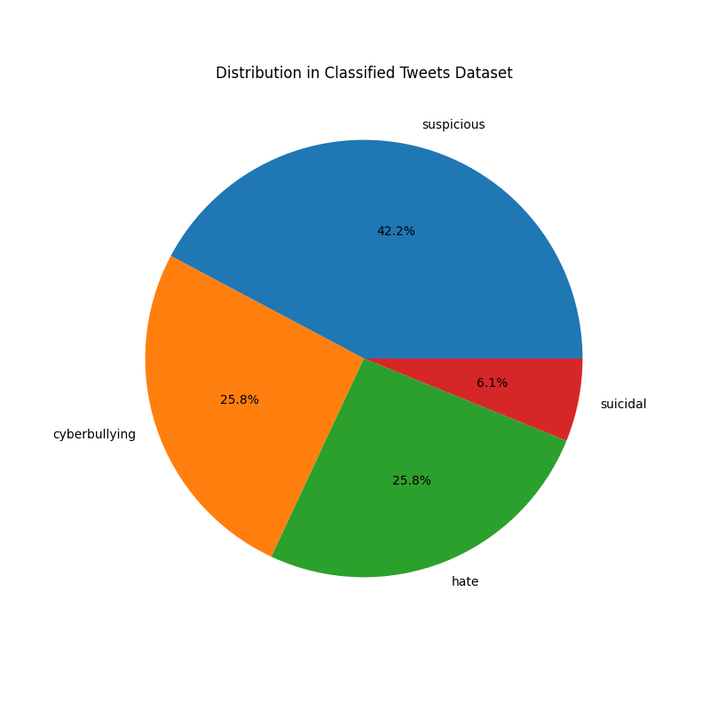
**Analysis:** If the external `classified_tweets.csv` dataset was loaded, this pie chart shows the proportion of suspicious, cyberbullying, hate, and suicidal labels.

## 15. Feature Correlation Heatmap
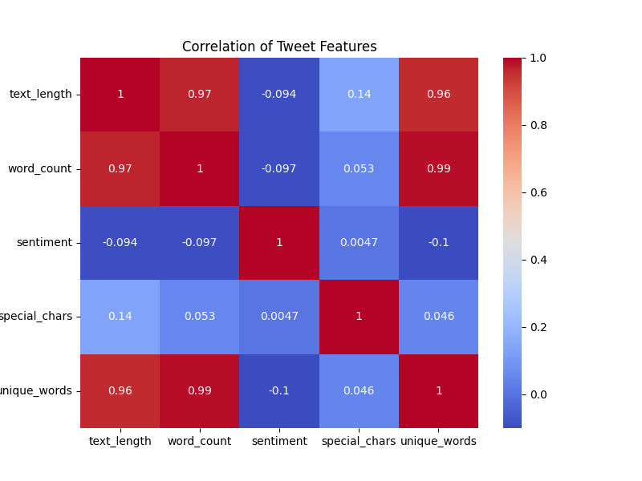
**Analysis:** Shows how numerical features (length, sentiment, special characters) correlate with each other. High correlation between length and word count is expected; sentiment might negatively correlate with special characters if aggressive punctuation is used.
